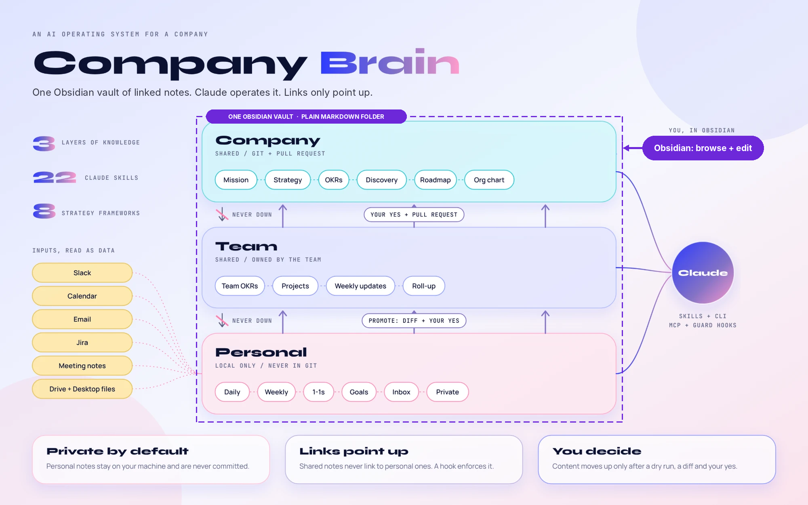
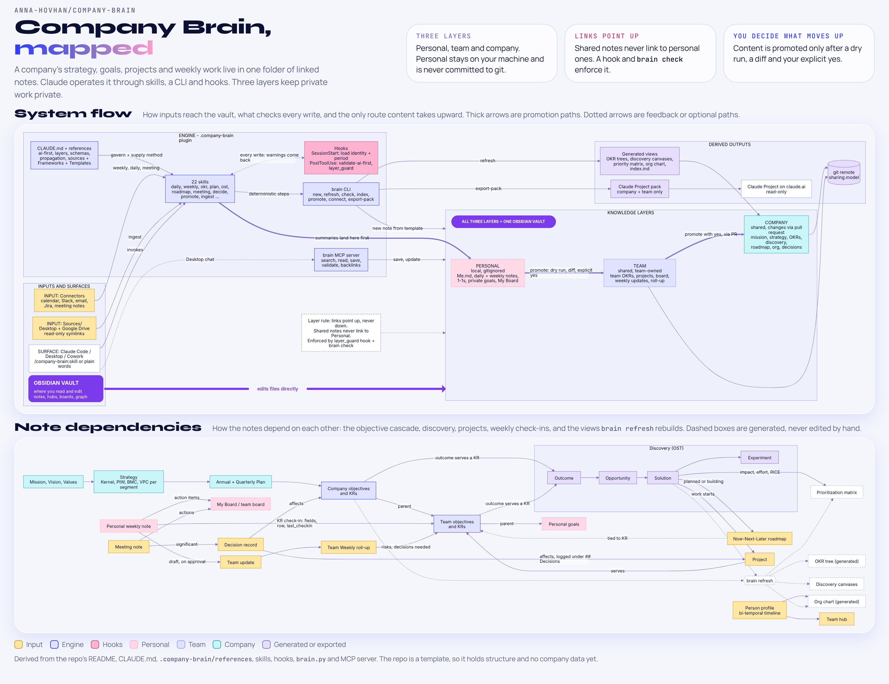

# Company Brain

An AI operating system for a company that lives in one folder. You browse and edit it in **Obsidian**. **Claude** operates it through a plugin with skills, hooks, an MCP server and a CLI. It shares knowledge in three layers: **personal**, **team** and **company**.

It's built on [obsidian-second-brain](https://github.com/eugeniughelbur/obsidian-second-brain), a single-person AI second brain, and extends it for multiplayer use. It also adds strategy and product frameworks: Value Proposition Canvas, Opportunity Solution Tree, Effort-Impact Matrix with RICE, OKRs, Strategy Kernel, Playing to Win, Business Model Canvas and Now-Next-Later roadmaps.



> **Open this folder as an Obsidian vault.** It is plain markdown: wikilinks, graph view, Dataview hubs and kanban boards work out of the box. See Quick start.

## What's inside

| Area | Where | What |
|---|---|---|
| Mission, vision, values | `Company/` | purpose statements with approval status and revision history |
| Strategy | `Company/Strategy/` | strategy kernel, Playing to Win, Business Model Canvas, one Value Proposition Canvas per segment |
| OKRs | `Company/OKRs/`, `Teams/<T>/OKRs/`, `Personal/Goals/` | annual and quarterly objectives, KRs with live progress fields, cascade via `parent:`, weekly check-ins, generated OKR trees |
| Planning | `*/Planning/` | annual and quarterly plans, operating cadence |
| Discovery | `*/Discovery/` | opportunity solution trees (outcome, opportunity, solution, experiment) rendered as Mermaid and as Obsidian canvases |
| Prioritization | `Company Prioritization`, `<Team> Prioritization` | generated effort-impact matrix and RICE ranking |
| Roadmap | `Company Roadmap`, `<Team> Roadmap` | Now / Next / Later kanban boards tied to key results |
| Organization | `Company/Org/`, `Teams/` | people profiles with bi-temporal history, team charters, generated org chart |
| Projects, meetings, decisions | `*/Projects/`, `*/Meetings/`, `*/Decisions/` | in the layer they belong to |
| Weekly operating rhythm | `Personal/Daily/`, `Personal/Weekly/`, `Teams/<T>/Weekly/` | daily and weekly notes that pull from calendar, Slack, email, Jira, Drive and meeting notes; per-person team updates; team roll-ups |
| Index and graph | `Home.md`, hubs, `index.md` | every note links to what it serves, so the Obsidian graph reads as one network, colour-coded by layer |

## How Claude accesses it

| Surface | Read | Write | Notes |
|---|---|---|---|
| Claude Code (CLI, desktop app, Cowork) with the `company-brain` plugin | yes | yes | 22 skills: `/company-brain:weekly`, `:okr`, `:ost`, `:vpc`, `:prioritize`, `:roadmap`, `:meeting`, and more |
| Claude Desktop chat | yes | yes | through the brain MCP server (see `System/Setup.md`) |
| claude.ai Project | yes | no | read-only pack made by `/company-brain:export` (company and team layers only) |

Why plugin-first: a Claude Project can't read local files, run hooks or automate, so it's only a read-only window. The plugin is the operating layer.

## Multiplayer layers

- `Company/` and `Teams/<Team>/` are shared and committed to git.
- `Personal/` is yours. It's gitignored and never leaves your machine.
- Links go **up** the stack, never down. A hook and `brain check` stop shared notes from linking to personal ones.
- Moving content up is always deliberate (`/company-brain:promote`): private sections are stripped, you see a diff, and it's written only after you say yes.
- Each person's weekly update is its own file, so git merges never conflict.

Details: `System/Layers and privacy.md` (human) and `.company-brain/references/layers.md` (spec).

## How it fits together

The top diagram shows how inputs, the Claude plugin and the three layers connect, and the only route content takes upward. The bottom one shows how the notes depend on each other, from mission down to weekly check-ins. Click the image for full size.

<a href="System/company-brain-map.png"></a>

## Quick start

1. **Obsidian**: open this folder as a vault, then enable the Dataview, Kanban, Templater and Calendar community plugins.
2. **Claude Code**:
   ```
   claude plugin marketplace add "/path/to/Company Brain"
   claude plugin install company-brain@company-brain
   ```
   Restart, open Claude in this folder, and run `/company-brain:setup`.
3. **Sources**: `/company-brain:connect` mounts Desktop or Google Drive folders under `Sources/` (read-only symlinks).
4. **Rhythm**: `/company-brain:daily` each morning, `/company-brain:weekly` on Fridays, `/company-brain:plan quarterly` each quarter.

The `./brain` CLI works without Claude: `./brain period`, `./brain new objective --title ...`, `./brain promote <note> --to team`, `./brain refresh`, `./brain check`, `./brain export-pack`. Requirements: `python3` (the stock macOS one works), plus `uv` for the MCP server.

New brains start from `.company-brain/scaffold/`. After editing `System/`, `Templates/`, `CLAUDE.md`, or `Home.md` here, run `./brain scaffold-sync` so new brains get the change (`./brain scaffold-sync --check` only reports drift). On macOS, `./brain scaffold-sync --watch` does this automatically in the background (launchd agent; `--unwatch` removes it).

To pick up improvements from obsidian-second-brain, run `./brain upstream-check`. It fetches the original repo and lists which of the files Company Brain borrowed (see `THIRD_PARTY_NOTICES.md`) changed since the commit recorded in `.company-brain/upstream.json`. `--diff` shows the changes, `--copy` takes the files we keep unchanged as they are, and after porting the adapted ones by hand `--mark` records the new commit; commit the result.

## Layout

```
Company Brain/
├── Home.md, CLAUDE.md, README.md, brain.yaml, brain (CLI)
├── Company/          company layer (shared)
├── Teams/<Team>/     team layer (shared, team-owned)
├── Personal/         personal layer (local only, gitignored)
├── Sources/          symlinked Desktop and Google Drive folders (local, read-only)
├── System/           how it works, frameworks, skills, automations, setup
├── Templates/        Templater templates (also used by the CLI)
├── .company-brain/           the Claude Code plugin: skills, hooks, MCP server, CLI, specs, scaffolds
├── .claude-plugin/   marketplace manifest (source: ./.company-brain)
└── .obsidian/        vault settings (graph colours by layer, templates, daily notes)
```

## License

MIT, (c) 2026 Anna Hovhannisyan. See `LICENSE`.

The AI-first note rules, write validator and vault MCP server are vendored from obsidian-second-brain (MIT, (c) 2026 Eugeniu Ghelbur); see `THIRD_PARTY_NOTICES.md`. Obsidian community plugins are not included in this repository; each user installs them from Obsidian.
